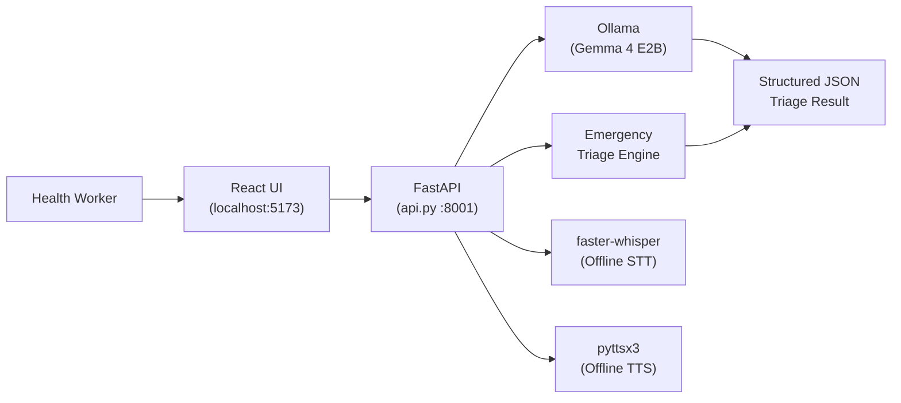
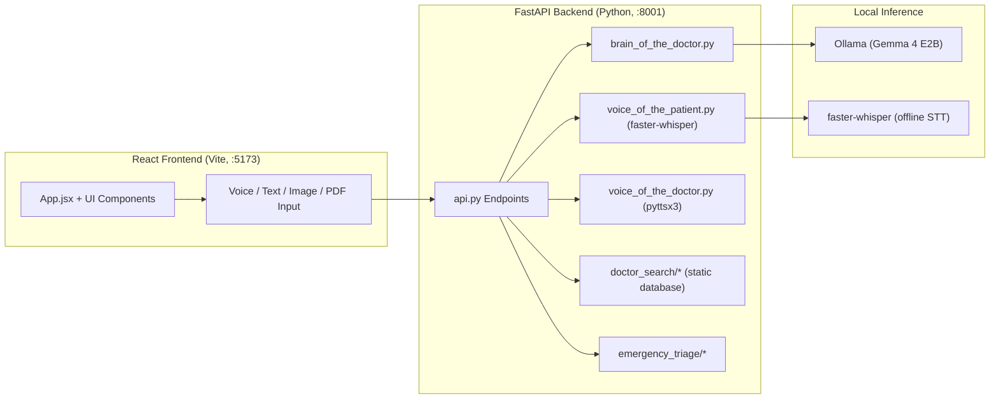

# 🏥 HealStation AI — Emergency Triage Assistant

> **Offline-first, multilingual clinical triage for frontline health workers in rural India**
> Powered by Gemma 4 (gemma4:e2b) · Runs entirely on-device · No internet required (specialThanks to Ollama)

[](https://ollama.com/library/gemma4)
[](https://ollama.com)
[](.)
[](https://python.org)
[](https://react.dev)
[](LICENSE)

---

## The Problem

India has fewer than 1 doctor per 1,500 people in rural areas. ASHA workers and frontline health workers
must make triage decisions daily — cardiac emergencies, strokes, trauma — often without specialist support
and with no reliable internet. Misdiagnosed cardiac events and delayed strokes cost thousands of lives every
year in regions where connectivity gaps make cloud-based AI impossible.

## The Solution

HealStation AI runs Gemma 4 locally via Ollama. ASHA workers and frontline health workers enter symptoms
in their own language — English, Hindi, or Marathi — and receive a structured clinical triage decision in
seconds. No internet. No patient data ever leaves the device.

## Why Gemma 4

Gemma 4 runs entirely on-device via Ollama. A health worker in rural Maharashtra with no internet
connectivity can open this app and receive a clinical triage decision in seconds. Patient data never
leaves their device — a critical requirement in healthcare. Cloud-only models like GPT-4 are impossible
in this context. Gemma 4's open weights and Apache license also mean this tool can be freely deployed
across India's public health system.

## Clinical Protocols

| Protocol | Use Case | Criteria |
|---|---|---|
| HEART Score | Chest pain / cardiac | History, ECG, Age, Risk factors, Troponin |
| BE-FAST | Stroke symptoms | Balance, Eyes, Face, Arms, Speech, Time |
| Trauma Score | Physical injuries | GCS, Respiratory Rate, Systolic BP |

## Architecture



## Hardware Requirements

| Spec | Minimum | Recommended |
|---|---|---|
| RAM | 8 GB | 16 GB |
| VRAM | 4 GB | 8 GB |
| Model | gemma2:2b | gemma4:e2b |
| OS | Windows / macOS / Linux | Any |

---

## Quick Start

### 1. Install Ollama and pull the model
```bash
# Install Ollama from https://ollama.com
ollama serve
ollama pull gemma4:e2b
# Low-spec alternative: ollama pull gemma2:2b  (then set OLLAMA_MODEL=gemma2:2b in .env)
```

### 2. Clone and set up backend
```bash
git clone https://github.com/aj4344/gemma-guardians-HealstationAI.git
cd gemma-guardians-HealstationAI

python -m venv .venv
# Windows: .venv\Scripts\activate
# macOS/Linux: source .venv/bin/activate

pip install -r requirements.txt

copy .env.example .env   # Windows
# cp .env.example .env   # macOS/Linux
```

### 3. Start the backend
```bash
python api.py
# Backend: http://127.0.0.1:8001
# Verify: GET /api/ollama-status → {"ollama":"connected","offline_ready":true}
```

### 4. Start the frontend
```bash
cd frontend
npm install
npm run dev
# Frontend: http://localhost:5173
```

---

## Features

- ✅ Fully offline inference (Ollama + Gemma 4)
- ✅ Multilingual: English, Hindi, Marathi
- ✅ HEART Score, BE-FAST, Trauma Score protocols
- ✅ Structured JSON triage output with confidence score
- ✅ Offline hospital routing (static database)
- ✅ Local speech-to-text (faster-whisper, no network required)
- ✅ Offline TTS (pyttsx3, no network required)
- ✅ Ayushman Bharat eligibility checker
- ✅ No patient data ever transmitted externally

## API Endpoints

| Method | Path | Description |
|---|---|---|
| GET | `/api/ollama-status` | Ollama + model health check |
| GET | `/api/stt-health` | faster-whisper STT status |
| POST | `/api/get-doctor-response` | Main triage consultation |
| POST | `/api/transcribe-audio` | Offline speech-to-text |
| POST | `/api/emergency-triage` | Emergency triage (HEART/BE-FAST/Trauma) |
| POST | `/api/emergency-hospitals` | Nearest hospital routing |

## Project Structure

```
gemma-guardians-HealstationAI/
├── api.py                     ← FastAPI backend
├── brain_of_the_doctor.py     ← Gemma 4 via Ollama
├── voice_of_the_patient.py    ← faster-whisper STT
├── voice_of_the_doctor.py     ← pyttsx3 TTS
├── config.py                  ← Central configuration
├── requirements.txt
├── .env.example
├── emergency_triage/          ← HEART / BE-FAST / Trauma engine
├── doctor_search/             ← Hospital routing services
├── tests/
│   └── test_emergency_triage.py
└── frontend/
    └── src/
        ├── App.jsx
        └── components/ui/
            ├── EmergencyTriage.jsx
            ├── AyushmanBharatCard.jsx
            └── AboutSection.jsx
```

## Validated By

Clinical protocols (HEART Score, BE-FAST, Trauma Score) and triage logic were reviewed and validated
by Three practicing physicians(Doctors) before submission.

## Ollama Special Track

This project is eligible for the **Ollama Special Mention** track — all Gemma 4 inference runs
entirely via Ollama for local, offline deployment. No cloud API is required for any part of the
core triage flow.

## Verification Checklist

```bash
ollama list                              # shows gemma4:e2b
python api.py                            # starts without errors
curl http://127.0.0.1:8001/api/ollama-status   # {"offline_ready":true}
curl -X POST http://127.0.0.1:8001/api/emergency-triage \
  -H "Content-Type: application/json" \
  -d '{"symptoms":"chest pain","language":"en"}'
# open http://localhost:5173             # frontend loads

```

## License

Apache 2.0 — free to deploy across India's public health system.

---

## Architecture



---

## Prerequisites

- Python 3.10 or newer
- Node.js 18 or newer
- npm (or pnpm/yarn)
- Ollama (required for Gemma 4 inference)


---

## Installation

### **Step 1: Clone Repository**

```bash
git clone git@github.com:aj4344/HealStation-AI-Doctor-Assistant.git

# Navigate into the project directory
cd HealStation-AI-Doctor-Assistant
```

---

### **Step 2: Backend Setup (Python)**

#### **Option A: Windows**
```cmd
# Create virtual environment
py -m venv .venv

# Activate virtual environment
.venv\Scripts\activate

# Upgrade pip
py -m pip install --upgrade pip

# Install dependencies
py -m pip install -r requirements.txt
```

#### **Option B: macOS/Linux**
```bash
# Create virtual environment
python3 -m venv .venv

# Activate virtual environment
source .venv/bin/activate

# Upgrade pip
pip install --upgrade pip

# Install dependencies
pip install -r requirements.txt
```

**⚠️ Troubleshooting PyAudio (Windows):**
If `PyAudio` installation fails:
```cmd
# Install precompiled wheel
pip install pipwin
pipwin install pyaudio
```

---

### **Step 3: Configure Environment Variables**

#### **Copy the example file:**
```bash
# Windows
copy .env.example .env

# macOS/Linux
cp .env.example .env
```


#### **Required offline settings:**

```env
# Ollama base URL (default for local)
OLLAMA_BASE_URL=http://localhost:11434
OLLAMA_MODEL=gemma4:e2b

# Low-spec alternative: OLLAMA_MODEL=gemma2:2b
```

#### **Optional STT/TTS tuning:**

```env
# Enable offline TTS (pyttsx3). Outputs .wav files.
LOCAL_TTS_ENABLED=true

# Enable offline STT (faster-whisper)
ENABLE_LOCAL_STT=true
LOCAL_STT_MODEL_SIZE=small  # use "tiny" for fastest demos
LOCAL_STT_MODEL_PATH=
LOCAL_STT_DEVICE=cpu
LOCAL_STT_COMPUTE_TYPE=int8
LOCAL_STT_CPU_THREADS=0
LOCAL_STT_NUM_WORKERS=1
```

---

### **Step 4: Frontend Setup (React + Vite)**

```bash
# Navigate to frontend directory
cd frontend

# Install dependencies (choose one)
npm install          # Using npm (recommended)
# or
pnpm install         # Using pnpm (faster)
# or
yarn install         # Using yarn

# Return to project root
cd ..
```

---

## ▶️ Running the Application

### **Method 1: Manual Start (Recommended for Development)**

You need **TWO terminal windows** running simultaneously:

#### **Terminal 1️⃣ - Start Backend (Python/FastAPI)**

```bash
# Make sure virtual environment is activated
# Windows: .venv\Scripts\activate
# macOS/Linux: source .venv/bin/activate

# Start FastAPI server
py api.py           # Windows
# or
python3 api.py      # macOS/Linux

# You should see:
# INFO:     Uvicorn running on http://127.0.0.1:8001
# INFO:     Application startup complete.
```

**Backend will be accessible at:** `http://127.0.0.1:8001`

**Test backend:**
```bash
# In a new terminal
curl http://127.0.0.1:8001/
# Should return: {"message":"Welcome to HealStation AI: Doctor Assistant API"}
```

#### **Terminal 2️⃣ - Start Frontend (React/Vite)**

```bash
# Navigate to frontend
cd frontend

# Start Vite dev server
npm run dev         # Using npm

# You should see:
# VITE v7.0.0  ready in XXX ms
# ➜  Local:   http://localhost:5173/
# ➜  Network: use --host to expose
```

**Frontend will be accessible at:** `http://localhost:5173`

**Open in browser:**
```
http://localhost:5173
```

---

### **Method 2: Optional Local Automation (User-Created)**

This repository currently does not include committed startup batch scripts.

If you want one-command startup on Windows, create your own local script (for example `start_all.bat`) and run backend + frontend commands from this README.

---

## ✅ Verification Checklist

After starting both servers, verify everything works:

- [ ] **Backend Running**: Visit `http://127.0.0.1:8001` → See welcome message
- [ ] **Frontend Running**: Visit `http://localhost:5173` → See app interface
- [ ] **API Connection**: Check browser console → No CORS errors
- [ ] **Ollama Status**: Visit `/api/ollama-status` → `{"offline_ready":true}`
- [ ] **Offline STT**: Try voice recording → faster-whisper transcribes locally
- [ ] **Offline Triage**: Click "Emergency Triage" → Results appear without network

---

## 🎯 First-Time Usage

### **Test the Application:**

1. **Select Language:** Choose English, Hindi (हिंदी), or Marathi (मराठी)
2. **Accept Disclaimer:** Read and accept the medical disclaimer
3. **Record Symptoms:** Click microphone and describe symptoms (or type)
4. **Upload Files (Optional):** Add medical images/PDFs
5. **Get Diagnosis:** Click "Get Triage Assessment"
6. **View Results:** See AI analysis with urgency level
7. **Find Doctors:** Click "Find Nearby Doctors & Hospitals"
8. **Check Ayushman Bharat:** Test health insurance eligibility

### **Sample Test Data:**

**Test Case 1: High Urgency**
```
Symptoms: "Severe chest pain, shortness of breath, sweating, I'm 52 years old"
Expected: HIGH urgency banner, Cardiologist recommendation
```

**Test Case 2: Medium Urgency**
```
Symptoms: "Persistent fever for 3 days, cough, body aches"
Expected: MEDIUM urgency, General Physician recommendation
```

**Test Case 3: Low Urgency**
```
Symptoms: "Minor skin rash on arm, no pain, started yesterday"
Expected: LOW urgency, Dermatologist recommendation
```

---

## 🛑 Stopping the Application

### **Method 1: Terminal**
- Press `Ctrl+C` in each terminal window
- Type `deactivate` to exit Python virtual environment

### **Method 2: Task Manager (Windows)**
```cmd
# Kill backend
taskkill /F /IM python.exe

# Kill frontend
taskkill /F /IM node.exe
```

### **Method 3: Activity Monitor (Mac)**
- Open Activity Monitor
- Search for "python" and "node"
- Force quit both processes

---

## 🔧 Development Commands

### **Backend Commands**
```bash
# Activate virtual environment
.venv\Scripts\activate  # Windows
source .venv/bin/activate  # Unix

# Install new package
pip install package-name
pip freeze > requirements.txt  # Update requirements

# Run with auto-reload
uvicorn api:app --reload --port 8001

# Check Python version
py --version
```

### **Frontend Commands**
```bash
cd frontend

# Development server
npm run dev

# Production build
npm run build

# Preview production build
npm run preview

# Lint code
npm run lint

# Install new package
npm install package-name
```

---

## 📦 Project Structure

```
HealStation-AI-Doctor-Assistant/
│
├── 📄 api.py                    # FastAPI backend server (port 8001)
├── 🧠 brain_of_the_doctor.py    # Core AI medical logic
├── 🎤 voice_of_the_patient.py   # Speech-to-text (faster-whisper, offline)
├── 🔊 voice_of_the_doctor.py    # Text-to-speech (pyttsx3, offline)
│
├── 🏥 Doctor Search Services
│   ├── advanced_doctor_service.py     # Primary search (1000+ hospitals)
│   ├── locationiq_doctor_service.py   # Legacy cloud API (not used in offline mode)
│   └── enhanced_doctor_service.py     # Fallback service
│
├── 📦 Configuration
│   ├── .env.example             # Environment variables template
│   ├── .gitignore               # Git ignore rules
│   ├── requirements.txt         # Python dependencies
│   └── README.md                # This file
│
├── 🎨 frontend/                 # React + Vite application
│   ├── src/
│   │   ├── App.jsx              # Main React component (2770 lines)
│   │   ├── components/          # Reusable UI components
│   │   │   ├── DoctorRecommendations.jsx
│   │   │   ├── LocationPermission.jsx
│   │   │   └── ui/
│   │   │       ├── AboutSection.jsx
│   │   │       ├── AyushmanBharatCard.jsx
│   │   │       ├── DisclaimerModal.jsx
│   │   │       └── BuyMeCoffeeSection.jsx
│   │   ├── styles/              # Theme and breakpoints
│   │   └── constants/           # Translations
│   │
│   ├── package.json             # Node dependencies
│   └── vite.config.js           # Vite configuration
│
└── 📄 VIDEO_SCRIPT_HACKATHON.md # Demo video script
```

---

## � Offline Configuration

No cloud API keys are required. All inference runs locally via Ollama.

### Verify Ollama is running
```bash
ollama list                              # shows gemma4:e2b
curl http://localhost:11434/api/tags     # confirms Ollama server
```

---

## 📊 API Endpoints

### Backend API (Port 8001)

#### 1. Core Health Endpoints
```
GET /
GET /api
GET /api/health-check
```

#### 2. Voice Transcription Endpoint
```
POST /api/transcribe-audio
Content-Type: multipart/form-data

Form fields:
  - audio: file (required)
  - language: en|hi|mr (optional, default: en)

Response:
{
  "text": "transcribed text",
  "language": "en"
}
```

#### 3. AI Consultation Endpoint
```
POST /api/get-doctor-response
Content-Type: application/json

Body:
{
  "patient_text": "string (required)",
  "language": "en|hi|mr",
  "image_data": ["base64_image_1", "base64_image_2"],
  "pdf_data": [{"name": "report.pdf", "data": "base64_pdf"}],
  "image_count": 0,
  "pdf_count": 0
}

Response:
{
  "doctor_response": "string",
  "audio_url": "/api/audio/doctor_response_<timestamp>.mp3",
  "specialist_recommendation": "cardiologist",
  "urgency_level": "low|medium|high"
}
```

#### 4. Audio Playback / Status Endpoints
```
GET /api/audio/{filename}        # streams MP3
GET /api/audio-status/{filename} # { ready, status, file_size }
GET /api/voices                  # supported TTS voices by language
```

#### 5. Doctor Discovery Endpoints
```
POST /api/search-doctors
Content-Type: application/json

Body:
{
  "latitude": 18.5204,
  "longitude": 73.8567,
  "specialty": "cardiologist",
  "radius": 25000,
  "sort_by": "distance|rating|reviews|availability|experience",
  "limit": 20,
  "language": "en",
  "ai_response": "optional diagnosis text"
}
```

```
POST /api/search-doctors-by-city
Content-Type: application/json

Body:
{
  "city": "Mumbai",
  "specialty": "dermatologist",
  "sort_by": "distance|rating|reviews|availability|experience",
  "limit": 20,
  "language": "en",
  "user_latitude": 18.5204,
  "user_longitude": 73.8567
}
```

```
GET /api/doctor-details/{place_id}
```

#### 6. Emergency Triage Endpoints
```
POST /api/emergency-triage
Content-Type: application/json

Body:
{
  "symptoms": "string (required)",
  "age": 52,
  "gender": "male|female|other",
  "vital_signs": {
    "blood_pressure_systolic": 140,
    "blood_pressure_diastolic": 90,
    "heart_rate": 98,
    "temperature_celsius": 38.2,
    "oxygen_saturation": 95,
    "respiratory_rate": 20
  },
  "medical_history": ["diabetes", "hypertension"],
  "symptom_duration": "2 hours",
  "language": "en|hi|mr",
  "latitude": 18.5204,
  "longitude": 73.8567,
  "ai_analysis": "optional prior AI analysis"
}
```

```
GET /api/emergency-triage/quick?symptoms=...
POST /api/emergency-hospitals
GET /api/emergency-info
```

---

## 🧩 Complete Code Reference (Function and Module Index)

This section is generated from the current source code and is the most accurate technical reference in this repository.

### Backend (Python) - Files, Classes, and Functions

#### `api.py` (FastAPI entrypoint)
- Pydantic request/response models:
  - `ConsultationRequest`, `ConsultationResponse`, `TranscriptionResponse`
  - `DoctorSearchRequest`, `DoctorSearchResponse`
  - `CitySearchRequest`, `CitySearchResponse`
  - `QuickTriageRequest`, `QuickTriageResponse`
- HTTP route handlers:
  - `read_root()` -> `GET /`
  - `api_health_check()` -> `GET /api`
  - `transcribe_audio(...)` -> `POST /api/transcribe-audio`
  - `get_consultation(...)` -> `POST /api/get-doctor-response`
  - `get_audio(filename)` -> `GET /api/audio/{filename}`
  - `get_voices()` -> `GET /api/voices`
  - `search_doctors_endpoint(request)` -> `POST /api/search-doctors`
  - `search_doctors_by_city_endpoint(request)` -> `POST /api/search-doctors-by-city`
  - `get_doctor_details(place_id)` -> `GET /api/doctor-details/{place_id}`
  - `check_audio_status(filename)` -> `GET /api/audio-status/{filename}`
  - `emergency_triage(request)` -> `POST /api/emergency-triage`
  - `quick_emergency_triage(symptoms)` -> `GET /api/emergency-triage/quick`
  - `find_emergency_hospitals(request)` -> `POST /api/emergency-hospitals`
  - `get_emergency_info()` -> `GET /api/emergency-info`
  - `health_check()` -> `GET /api/health-check`
- Utility functions:
  - `generate_audio_background(text, output_path, language)`
  - `cleanup_old_audio_files()`

#### `brain_of_the_doctor.py` (primary AI consultation logic)
- Prompt and model utilities:
  - `get_system_prompt(language_code="en")`
- AI generation functions:
  - `get_doctor_advice_multimodal(patient_input, image_data_list=None, pdf_data_list=None, language="en")`
  - `get_doctor_advice_text_only(patient_input, language="en")`
- Post-processing and compatibility:
  - `extract_specialist_recommendation(doctor_response)`
  - `get_doctor_response(patient_message, image_data=None, pdf_data=None, language="en")`
  - `encode_image(image_path)`

#### `voice_of_the_patient.py` (speech-to-text)
- `improve_transcription(text, language_code="en")`
  - Corrects common Marathi/Hindi misheard words and cleans noisy text.
- `transcribe_audio_offline(audio_path, language_code="en")`
  - Uses faster-whisper locally with language-specific prompt hints.

#### `voice_of_the_doctor.py` (text-to-speech)
- Text cleaning and TTS core:
  - `clean_text_for_audio(text, language="en")`
  - `_main_tts(text, output_filepath, lang='en')`
  - `_text_to_speech_core(text, output_filepath, lang='en')`
- Public TTS helpers:
  - `generate_doctor_voice(...)`
  - `speak_as_doctor(...)`
  - `get_doctor_voice_for_ui(...)`
  - `text_to_speech_for_api(text, output_path, language="en")`
  - `get_available_voices()`
- Offline-first: pyttsx3 is the primary engine; no network required.

#### `advanced_doctor_service.py` (primary doctor search implementation)
- Class: `AdvancedDoctorSearchService`
- Key methods:
  - `_calculate_distance(...)`, `_calculate_distance_km(...)`
  - `_determine_city(...)`
  - `_get_prominent_doctors(...)`
  - `_is_available_today(...)`
  - `_get_verified_rating(...)`, `_get_verified_reviews_count(...)`
  - `_get_verified_hours()`, `_get_verified_availability()`
  - `search_doctors_enhanced(...)`
  - `_apply_advanced_sorting(doctors, sort_by)`
  - `search_doctors_by_city(...)`
  - `_geocode_city(city)`
- Module-level async wrappers:
  - `search_doctors_enhanced(...)`
  - `search_doctors_by_city(...)`
  - `test_advanced_search()`

#### `enhanced_doctor_service.py` (older combined search layer)
- Class: `EnhancedDoctorSearchService`
- Methods:
  - `_calculate_distance(...)`
  - `_determine_city(...)`
  - `_get_prominent_doctors(...)`
  - `search_doctors_enhanced(...)`
- Module-level wrappers:
  - `search_doctors_enhanced(...)`, `test_enhanced_search()`

#### `emergency_triage/` package

- `constants.py`
  - Defines `TRIAGE_LEVELS`, keyword sets (`CRITICAL_KEYWORDS`, `EMERGENCY_KEYWORDS`, `URGENT_KEYWORDS`), HEART/BE-FAST/TRAUMA configs, vital thresholds, emergency numbers, specialist mapping, and hospital capability requirements.

- `models.py`
  - Pydantic models and enums:
    - `TriageLevel`, `VitalSigns`, `EmergencyTriageRequest`
    - `HeartScore`, `BeFastScore`, `TraumaScore`, `EmergencyScores`
    - `EmergencyHospital`, `EmergencyAction`, `HospitalSearchRequest`, `TriageResponse`

- `triage_service.py`
  - Class: `TriageService`
  - Scoring methods:
    - `calculate_all_scores(...)`
    - `calculate_heart_score(...)`
    - `calculate_befast_score(...)`
    - `calculate_trauma_score(...)`
    - `quick_keyword_check(symptoms)`
  - Internal helpers:
    - `_compile_patterns()`, `_assess_vital_signs(vitals)`, `_check_respiratory_concern(symptoms)`

- `emergency_classifier.py`
  - Class: `EmergencyClassifier`
  - Main APIs:
    - `classify(request)`
    - `quick_classify(symptoms)`
  - Internal decision helpers:
    - `_score_to_level(scores)`
    - `_determine_emergency_type(...)`
    - `_detect_conditions(...)`
    - `_determine_time_sensitivity(level)`
    - `_generate_primary_action(...)`
    - `_generate_secondary_actions(...)`
    - `_get_specialist_recommendation(emergency_type)`
    - `_generate_assessment(...)`
    - `_calculate_confidence(...)`

- `hospital_routing_service.py`
  - Class: `HospitalRoutingService`
  - Multi-source routing methods:
    - `find_emergency_hospitals(request)`
    - `_search_overpass(...)`
    - `_parse_overpass_response(...)`
    - `_build_address_from_tags(tags)`
    - `_get_static_hospitals(...)`
    - `_score_and_sort(...)`
    - `_haversine(...)`
    - `get_nearest_hospital(hospitals)`
    - `get_best_match(hospitals, emergency_type)`

#### Utility and test scripts (backend)
- `test_emergency_triage.py` - end-to-end tests for scoring, classification, vitals, and hospital routing.
- `test_sorting_fix.py` - validates sorting modes (`distance`, `rating`, `reviews`, city-based).
- `quick_test.py` - quick smoke test of prominent doctor list in `EnhancedDoctorSearchService`.
- `check_offline_ready.py` - verifies Ollama and all offline components are healthy.
- `benchmark_offline.py` - benchmarks local inference speed.
- `brain_of_the_doctor_fixed.py` - alternate/legacy AI pipeline retained for reference/debug workflows.

---

### Frontend (React) - Files, Components, and Key Functions

#### Core app files
- `frontend/src/main.jsx`
  - React root bootstrap; renders `<App />` in `StrictMode`.
- `frontend/src/App.jsx` (main app orchestrator)
  - Internal components: `DiagnosisLoading`, `AudioPlayer`.
  - Major handlers/functions:
    - `checkApiConnection()`
    - `handleLanguageSelect(...)`, `handleDisclaimerAccept()`
    - `startRecording()`, `stopRecording()`, `toggleRecording()`
    - `transcribeAudio(audioBlob)`
    - `handleFileUpload(...)`, `removeFile(index)`
    - `pollAudioStatus(filename, maxAttempts)`
    - `handleSubmit()`
    - `resetConsultation()`
    - `handleLocationGranted(location)`, `handleLocationDenied()`
    - `handleFindDoctors()`
    - `copyToClipboard(text)`, `downloadAudio(...)`, `downloadTranscription()`

#### Shared component folder: `frontend/src/components/`
- `ConsultationPanel.jsx`
  - Export: `ConsultationPanel`
  - Functions: `handleRecordingComplete(...)`, `handleImageUpload(...)`, `handleSubmit(...)`, `toggleAudio()`, `handleAudioEnded()`.
- `DoctorRecommendations.jsx`
  - Export: default `DoctorRecommendations`
  - Functions: `searchDoctors()`, `searchDoctorsByCity()`, `handleFilterChange(...)`, `renderStars(...)`, `getDirections(...)`, `callDoctor(...)`, `visitWebsite(...)`.
- `LocationPermission.jsx`
  - Export: default `LocationPermission`
  - Functions: `requestLocation()`, `handleDeny()`, `handleSearchByCity()`.
- `Header.jsx` -> export `Header`
- `Footer.jsx` -> export `Footer`
- `Sidebar.jsx` -> export `Sidebar`
- `LoadingSpinner.jsx` -> export `LoadingSpinner`
- `GlowCard.jsx` -> export default `GlowCard`
- `TestComponent.jsx` -> export default `TestComponent`

#### UI component folder: `frontend/src/components/ui/`
- `EmergencyButton.jsx`
  - Exports: `EmergencyButton`, `FloatingEmergencyButton`, default export.
  - Integrates `EmergencyTriage` modal and one-tap 108 call action.
- `EmergencyTriage.jsx`
  - Exports: `EmergencyTriage`, default export.
  - Core functions: `requestLocation(...)`, `toggleQuickSymptom(...)`, `performTriage(...)`, `openDirections(hospital)`.
  - Calls: `/api/emergency-triage`, `/api/emergency-triage/quick`.
- `DisclaimerModal.jsx` - user consent modal for medical/legal/privacy terms.
- `AboutSection.jsx` - project overview/about modal.
- `AyushmanBharatCard.jsx`
  - Eligibility checker UI with `handleInputChange(...)`, `checkEligibility(...)`, `generateBeneficiaryID()`.
- `BuyMeCoffeeSection.jsx`
  - Support modal with payment UI and `generateUPILink()`.
- `DiagnosisLoading.jsx` - enhanced loading overlay animations.
- `EnhancedAudioRecorder.jsx` - alternate recorder (`stopRecording`, `clearRecording`, `togglePlayback`, `downloadAudio`, `formatTime`).
- `EnhancedFileUpload.jsx` - drag/drop file intake (`handleDragOver`, `handleDragLeave`, `handleDrop`, `handleFileSelect`, `handleFiles`, `removeFile`, `formatFileSize`, `getFileIcon`).
- `EnhancedHeader.jsx` - alternate responsive header.
- `modern-ui.jsx`
  - Utility: `cn(...)`
  - Exports reusable design primitives: `Card`, `CardHeader`, `CardContent`, `CardTitle`, `CardDescription`, `Input`, `Textarea`, `Button`, `Badge`, `Separator`, `Skeleton`, `Alert`, `AlertTitle`, `AlertDescription`.
- `ModernPatientPanel.jsx`, `ModernDoctorPanel.jsx`, `QuickWelcome.jsx`, `WelcomeLanding.jsx`
  - Alternate/newer UX building blocks and onboarding surfaces.

#### 3D component folder: `frontend/src/components/ThreeD/`
- `MedicalScene.jsx` -> export default `ThreeDMedicalCanvas`
- `LoadingAnimation.jsx` -> export default `ThreeDLoadingCanvas`
- `VoiceInput3D.jsx` -> export default `VoiceInput3DCanvas`
- `FileUpload3D.jsx` -> export default `FileUpload3DCanvas`
- `DoctorAnalysis3D.jsx` -> export default `DoctorAnalysis3DCanvas`
- `EnhancedMedicalCanvas.jsx` -> export default `EnhancedMedicalCanvas`
- `Enhanced3DFileUpload.jsx` -> export default `Enhanced3DFileUpload`
- `index.js`
  - Re-exports: `ThreeDMedicalCanvas`, `ThreeDLoadingCanvas`, `VoiceInput3DCanvas`, `FileUpload3DCanvas`, `DoctorAnalysis3DCanvas`.

#### Constants and styling
- `frontend/src/constants/translations.js` -> export `TRANSLATIONS` (EN/HI/MR UI copy).
- `frontend/src/styles/themes.js` -> exports `lightTheme`, `darkTheme`, `glassMorphismTheme`.
- `frontend/src/styles/breakpoints.js` -> exports `breakpoints`, `media` helpers.
- `frontend/src/TestApp.jsx` -> simple test harness mounting `TestComponent`.

---

### Environment Variables (code-verified)

Required for offline inference:
- `OLLAMA_BASE_URL` (default: `http://localhost:11434`) - Ollama server address
- `OLLAMA_MODEL` (default: `gemma4:e2b`) - model tag to use

Optional model overrides:
- `OLLAMA_NUM_CTX` - context window size
- `OLLAMA_NUM_PREDICT` - max tokens to generate
- `OLLAMA_TEMPERATURE` - sampling temperature

Offline STT settings:
- `ENABLE_LOCAL_STT` (default: `true`) - enable local STT (faster-whisper)
- `LOCAL_STT_MODEL_SIZE` (default: `small`) - Whisper model size (tiny/base/small/medium)
- `LOCAL_STT_MODEL_PATH` (optional) - local model directory path
- `LOCAL_STT_DEVICE` (default: `cpu`) - `cpu` or `cuda`
- `LOCAL_STT_COMPUTE_TYPE` (default: `int8`) - faster-whisper compute type
- `LOCAL_STT_CPU_THREADS` (default: `0`) - auto when 0
- `LOCAL_STT_NUM_WORKERS` (default: `1`) - decode workers

Offline TTS settings:
- `LOCAL_TTS_ENABLED` (default: `true`) - enable local TTS (pyttsx3, outputs `.wav`)

---

### Runtime Data Flow (actual implementation)

1. User records audio or enters text in frontend.
2. Audio (if present) -> `POST /api/transcribe-audio`.
3. Consultation payload (text + optional image/pdf base64) -> `POST /api/get-doctor-response`.
4. Backend AI pipeline (`brain_of_the_doctor.py`) returns structured diagnosis + specialist + urgency.
5. Backend TTS pipeline (`voice_of_the_doctor.py`) generates MP3 in `audio_outputs/`.
6. Frontend polls `GET /api/audio-status/{filename}` and then plays `GET /api/audio/{filename}`.
7. If user chooses doctor discovery, frontend calls:
   - `POST /api/search-doctors` (location-based), or
   - `POST /api/search-doctors-by-city` (city query).
8. Emergency flow uses `EmergencyButton` / `EmergencyTriage` and calls:
   - `POST /api/emergency-triage` (full), fallback `GET /api/emergency-triage/quick`.
   - Optional hospital lookup via `POST /api/emergency-hospitals`.

---

## 🎯 Features in Detail

### 1. AI Medical Consultation

**How It Works:**
1. Patient records symptoms via voice or text
2. Optionally uploads medical images/PDFs
3. Gemma 4 via Ollama analyzes input locally
4. AI generates professional medical assessment
5. System identifies appropriate specialist
6. Response converted to audio (pyttsx3 offline TTS)
7. Audio delivered with text transcript

**Supported Specialties (20+):**
- Dermatologist (skin conditions)
- Cardiologist (heart issues)
- Orthopedic (bones/joints)
- Neurologist (brain/nervous system)
- Pediatrician (children's health)
- Gynecologist (women's health)
- Ophthalmologist (eye conditions)
- Pulmonologist (lungs/respiratory)
- Urologist (urinary system)
- Nephrologist (kidney disease)
- ENT (ear/nose/throat)
- Gastroenterologist (digestive system)
- Psychiatrist (mental health)
- Endocrinologist (hormones/diabetes)
- Rheumatologist (autoimmune)
- And more...

### 2. Location-Based Doctor Discovery 

**What Was Fixed:**
- ✅ Sorting algorithm now handles mixed data types (numeric ratings + "Contact for ratings" strings)
- ✅ Added safe numeric extraction helpers
- ✅ Fixed `available_today` boolean vs string issue
- ✅ Top-rated and most-reviewed sorting now works correctly
- ✅ All 4 sorting modes verified: distance, rating, reviews, city-based

**Data Sources:**
1. **Static Medical Database**: 1000+ verified hospitals in Indian cities
2. **OpenStreetMap**: Used for hospital location data
3. **Enhanced Fallback**: Additional search when needed

**Search Capabilities:**
- Find doctors within 50km radius
- Search specific cities without GPS
- Filter by specialty (20+ options)
- Sort by: nearest, top-rated, most-reviewed, availability
- Semantic matching from AI diagnosis
- Distance calculation to user location
- Phone numbers and addresses included

**Medical Safety:**
- ✅ NO fake data generation
- ✅ Only verified facilities shown
- ✅ Unverified facilities marked "Contact for ratings"
- ✅ Real phone numbers and addresses
- ✅ Source attribution (static database)

### 3. Voice Interaction

**Speech-to-Text:**
- Engine: faster-whisper (local, no network required)
- Languages: English, Hindi, Marathi
- Offline transcription
- Smart corrections for Indian languages
- Handles medical terminology

**Text-to-Speech:**
- Primary: pyttsx3 (fully offline)
- Languages: English, Hindi, Marathi
- Natural medical voices
- Markdown cleaning for better audio

### 4. Medical Document Processing

**Supported Files:**
- **Images**: JPG, PNG, JPEG, WebP (X-rays, skin photos, medical scans)
- **PDFs**: Lab reports, medical records, prescriptions
- **Limit**: 8 files total per consultation
- **Processing**: Base64 encoding for secure transmission

**Analysis:**
- Extract lab values and ranges
- Identify abnormalities in images
- Interpret diagnostic conclusions
- Cross-reference with symptoms

---

## 🌍 Multilingual Support

### Supported Languages

| Language | Code | UI | Voice Input | Voice Output | Medical Terms |
|----------|------|----|-----------|--------------|--------------| 
| English | `en` | ✅ | ✅ | ✅ | ✅ |
| Hindi (हिंदी) | `hi` | ✅ | ✅ | ✅ | ✅ |
| Marathi (मराठी) | `mr` | ✅ | ✅ | ✅ | ✅ |

### Translation Coverage
- All UI elements
- System prompts
- Medical responses
- Error messages
- Loading states
- Button labels

---

## 🛠️ Technology Stack

### Backend
- **Framework**: FastAPI 0.110.0
- **Server**: Uvicorn (ASGI)
- **AI/LLM**: Ollama (Gemma 4 E2B)
- **STT**: faster-whisper (local)
- **TTS**: pyttsx3 (offline)
- **PDF Processing**: PyPDF2 3.0.1
- **HTTP Client**: aiohttp 3.8.6, httpx 0.27.0
- **Environment**: python-dotenv 1.0.1

### Frontend
- **Framework**: React 19.1.0
- **Build Tool**: Vite 7.0.0
- **Styling**: Styled Components 6.1.19
- **Animations**: Framer Motion 12.19.2
- **HTTP Client**: Axios 1.10.0
- **Voice Recording**: react-audio-voice-recorder 2.2.0
- **Icons**: React Icons 5.5.0

### Local Services
- **AI**: Ollama (Gemma 4 E2B, fully offline)
- **STT**: faster-whisper (on-device)
- **TTS**: pyttsx3 (offline)
- **Maps Data**: OpenStreetMap

---

## 🧪 Testing

### Manual Testing

**Test Consultation:**
```bash
# Terminal 1
py api.py

# Terminal 2 (from frontend/)
npm run dev

# Open browser: http://localhost:5173
# Test: Record voice → Upload image → Get diagnosis
```

**Test Doctor Search:**
```bash
# After getting diagnosis, click "Find Nearby Doctors"
# Allow location access or search by city
# Test sorting: Distance, Rating, Reviews
```

### API Testing

**Using curl:**
```bash
# Health check
curl http://127.0.0.1:8001/

# Doctor search (replace coordinates)
curl -X POST http://127.0.0.1:8001/api/search-doctors \
  -H "Content-Type: application/json" \
  -d '{
    "latitude": 18.5204,
    "longitude": 73.8567,
    "specialty": "cardiologist",
    "sort_by": "rating",
    "limit": 5
  }'
```

**Using Python:**
```python
import asyncio
from advanced_doctor_service import search_doctors_enhanced

async def test():
    doctors = await search_doctors_enhanced(
        specialty='cardiologist',
        latitude=18.5204,
        longitude=73.8567,
        sort_by='rating',
        limit=5
    )
    print(f"Found {len(doctors)} doctors")
    for doc in doctors:
        print(f"{doc['name']} - {doc['rating']}⭐ - {doc['distance_km']}km")

asyncio.run(test())
```

---

## 📝 Usage Examples

### Example 1: Voice Consultation
```
1. Select language: English
2. Click microphone → Record: "I have chest pain and shortness of breath"
3. Upload X-ray image (optional)
4. Click "Get Doctor's Diagnosis"
5. Receive: AI analysis + audio response + specialist recommendation
6. Click "Find Nearby Doctors" → Location-based cardiologists
```

### Example 2: Text + PDF Consultation
```
1. Select language: Hindi
2. Type symptoms in text box
3. Upload lab report PDF
4. Get comprehensive analysis in Hindi
5. Audio plays in Hindi voice
6. Search for specialists in your city
```

### Example 3: City-Based Doctor Search
```
1. Complete consultation
2. Get specialist recommendation
3. Search by city: "Mumbai"
4. Sort by: "Top Rated"
5. View doctors with verified ratings and contact info
```

---

## 🔒 Security & Privacy

### Data Handling
- ✅ Audio files deleted after 1 hour automatically
- ✅ No patient data stored permanently
- ✅ Secure Base64 encoding for files
- ✅ CORS configured for frontend origin
- ✅ Environment variables for sensitive keys
- ✅ No fake medical data generation

### API Security
- Input validation on all endpoints
- File size limits enforced
- Secure multipart form handling
- No external API calls = no rate limits or key exposure

### Medical Disclaimer
⚠️ **IMPORTANT**: This AI tool is for educational and informational purposes only. It is NOT a substitute for professional medical advice, diagnosis, or treatment. Always consult with qualified healthcare professionals for medical concerns.

---

## 🐛 Troubleshooting

### Common Issues

**1. Backend won't start**
```bash
# Check Python version
py --version  # Should be 3.10+

# Check if port 8001 is in use
netstat -ano | findstr :8001

# Kill process if needed
taskkill /PID <PID> /F

# Reinstall dependencies
pip install -r requirements.txt --force-reinstall
```

**2. Frontend won't start**
```bash
# Clear cache
npm cache clean --force

# Delete node_modules and reinstall
rm -rf node_modules package-lock.json
npm install

# Try different port
npm run dev -- --port 3000
```

**3. Audio recording not working**
```bash
# Check browser permissions
# Chrome: Settings → Privacy → Site Settings → Microphone
# Allow microphone access for localhost

# Check if PyAudio is installed
pip show pyaudio
```

**4. Ollama not responding**
```bash
# Check Ollama is running
ollama serve

# Verify model is pulled
ollama list | findstr gemma4:e2b   # Windows
ollama list | grep gemma4:e2b      # macOS/Linux
```

**5. Sorting not working correctly**

- Updated `advanced_doctor_service.py`
- Added safe numeric extraction helpers
- Now handles mixed data types properly

---

## 📦 Maintenance & Cleanup

### Current Repository State

No automated cleanup scripts are currently committed in this repository.

Recommended maintenance practices:
- Remove stale files only after running tests and manual API checks
- Keep `audio_outputs/` trimmed if it grows too large
- Re-run `test_emergency_triage.py` and `test_sorting_fix.py` after major backend changes

---

## 🚀 Deployment

### Production Considerations

**Backend:**
- Use Gunicorn with Uvicorn workers
- Set `reload=False` in production
- Configure proper CORS origins
- Use environment-specific .env files
- Set up logging and monitoring
- Implement rate limiting
- Use HTTPS

**Frontend:**
- Build for production: `npm run build`
- Serve via Nginx or Apache
- Configure environment variables
- Enable compression (gzip)
- Use CDN for assets
- Implement caching headers

**API Keys:**
- Never commit `.env` to Git
- Use secret management services
- Rotate keys periodically
- Monitor usage and limits

---

## 🤝 Contributing

Contributions are welcome! Please follow these guidelines:

1. Fork the repository
2. Create feature branch: `git checkout -b feature/amazing-feature`
3. Commit changes: `git commit -m 'Add amazing feature'`
4. Push to branch: `git push origin feature/amazing-feature`
5. Open a Pull Request

### Development Setup
```bash
# Install dev dependencies
pip install -r requirements-dev.txt

# Run linters
black brain_of_the_doctor.py
flake8 api.py

# Frontend linting
npm run lint
```

---

## 📄 License

This project is licensed under the MIT License - see the LICENSE file for details.

---

## 👥 Authors

- **AJ** - *Initial work* - [@aj4344](https://github.com/aj4344)

---

## 🙏 Acknowledgments

- **Google** - For Gemma 4 open weights
- **Ollama** - For local model serving
- **OpenStreetMap** - For medical facility data
- **faster-whisper** - For on-device speech-to-text
- **FastAPI** - For the excellent Python framework
- **React** - For the powerful UI library

---

## 📊 Project Stats

- **Total Lines of Code**: ~15,000+
- **Backend Files**: 8 core Python modules
- **Frontend Components**: 10+ React components
- **API Endpoints**: 7 main endpoints
- **Supported Languages**: 3 (EN, HI, MR)
- **Supported Specialties**: 20+
- **Medical Facilities Database**: 1000+ hospitals


---

## 🔮 Future Roadmap

- [ ] Add more Indian languages (Tamil, Telugu, Bengali)
- [ ] Implement appointment booking system
- [ ] Add telemedicine video consultation
- [ ] Integrate with ABDM (Ayushman Bharat Digital Mission)
- [ ] Add prescription generation
- [ ] Implement medical history tracking
- [ ] Add symptoms checker with visual body map
- [ ] Electronic health records (EHR) support

---

## 📞 Contact

- 📧 **Email**: jabhijeet789@gmail.com
- 🐛 **Issues**: [GitHub Issues](https://github.com/aj4344/gemma-guardians-HealstationAI/issues)
- 💬 **Discussions**: [GitHub Discussions](https://github.com/aj4344/gemma-guardians-HealstationAI/discussions)

---

## ⭐ Show Your Support

If you find this project helpful, please consider:
- ⭐ Starring the repository
- 🔀 Forking for your own use
- 🐛 Reporting bugs
- 💡 Suggesting features
- 📣 Sharing with others

---

<div align="center">

**Made with ❤️ and 🤖 AI**

*HealStation AI: Doctor Assistant - Revolutionizing Medical Consultation*

</div>


