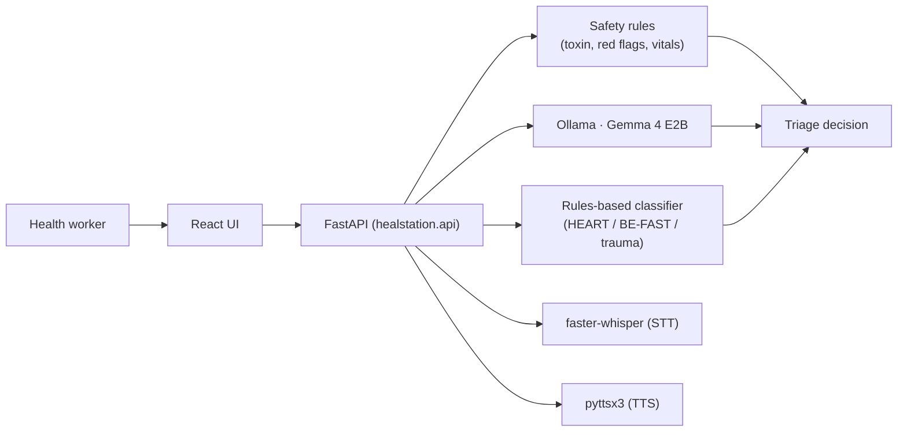

# 🏥 HealStation AI — Emergency Triage Assistant

> **Offline-first, multilingual clinical triage for frontline health workers in rural India.**
> Gemma 4 (`gemma4:e2b`) runs on the device through Ollama. No internet is needed and no patient data
> leaves the device.

[](https://ollama.com/library/gemma4)
[](https://ollama.com)
[](.)
[](https://python.org)
[](https://react.dev)
[](LICENSE)

> ⚠️ **Decision support, not diagnosis.** HealStation AI helps a health worker decide how urgently a patient
> needs care and where to refer them. A clinician makes the decision. In an emergency, call **108**.

---

## The problem

India has fewer than one doctor per 1,500 people in rural areas. ASHA workers and other frontline health
workers make triage decisions every day — cardiac emergencies, strokes, poisoning, trauma — often without
specialist support and without reliable internet, so cloud AI is not an option.

## What HealStation AI does

A worker describes the patient's symptoms by voice or text in **English, Hindi or Marathi** and adds vital
signs if they have them. HealStation AI returns a structured triage decision: urgency, the reasons for it,
what to do now, which specialist is needed, and the nearest capable hospital.

Safety comes first and does not depend on the model:

1. **Toxin fast lane** — poisoning and chemical exposure are recognised before anything else.
2. **Red-flag guardrail** — chest pain, stroke signs, breathing distress, severe bleeding, unconsciousness,
   seizures, anaphylaxis and self-harm risk are detected by deterministic rules in all three languages.
3. **Critical vital signs** — a critical reading always means HIGH urgency.
4. **Gemma 4** assesses everything else; when it is unavailable or unsure, a rules-based classifier
   (HEART, BE-FAST and trauma scoring) takes over. A model can raise urgency but never lower what a safety
   rule decided, and a patient nobody assessed is never shown as "low".

## Clinical protocols

| Protocol | Use case | Criteria |
|---|---|---|
| HEART Score | Chest pain / cardiac | History, ECG, Age, Risk factors, Troponin |
| BE-FAST | Stroke symptoms | Balance, Eyes, Face, Arms, Speech, Time |
| Trauma Score | Physical injuries | GCS, Respiratory Rate, Systolic BP |

## Architecture



See [docs/architecture.md](docs/architecture.md) for the module map and request flow, and
[docs/PRD.md](docs/PRD.md) for the production-readiness plan.

## Hardware

| Spec | Minimum | Recommended |
|---|---|---|
| RAM | 8 GB | 16 GB |
| VRAM | none (CPU works) | 4–8 GB |
| Model | `gemma2:2b` | `gemma4:e2b` |
| OS | Windows 11 / Ubuntu 22.04+ / macOS | any |

Measured numbers are in [docs/benchmarks.md](docs/benchmarks.md).

---

## Quick start

### 1. Ollama and the model
```bash
# Install Ollama from https://ollama.com, then:
ollama serve
ollama pull gemma4:e2b
# Low-spec alternative: ollama pull gemma2:2b and set OLLAMA_MODEL=gemma2:2b in .env
```

### 2. Backend (Python 3.10–3.13)
```bash
git clone https://github.com/aj4344/gemma-guardians-HealstationAI.git
cd gemma-guardians-HealstationAI
python -m venv .venv
# Windows: .venv\Scripts\activate     macOS/Linux: source .venv/bin/activate
pip install --require-hashes -r requirements.lock
# Linux only, for offline voice output: sudo apt install espeak-ng
cp .env.example .env            # Windows: copy .env.example .env
python download_stt_model.py    # once, while online: the speech-to-text model
python check_offline_ready.py   # verifies the model, Whisper and the safety rules
python api.py                   # http://127.0.0.1:8001
```

### 3. Frontend
```bash
cd frontend
npm ci
npm run dev        # http://localhost:3000 (proxies /api to :8001)
```

### 4. Production: one offline process
```bash
cd frontend && npm ci && npm run build && cd ..
python api.py      # UI and API both on http://127.0.0.1:8001; Node.js is not needed at runtime
```
Read [Deployment](#deployment) before exposing it to anyone else.

---

## Features

- Fully offline inference (Ollama + Gemma 4); no cloud API keys
- English, Hindi and Marathi for input, results and voice output
- Deterministic safety rules ahead of the model (toxin lane, red flags, critical vitals)
- Structured triage output with reasons, actions, specialist and confidence
- Offline speech-to-text (faster-whisper) and text-to-speech (pyttsx3)
- Offline emergency-hospital list and specialist directory (facility-level, unverified listings are labelled)
- Ayushman Bharat (PM-JAY) information card

Uploaded images and PDFs are accepted by the current API but **not yet analysed**; document, photo and
scan analysis is being built as described in the PRD.

## API

The backend serves interactive OpenAPI docs at `http://127.0.0.1:8001/docs`. The main endpoints:

| Method | Path | Description |
|---|---|---|
| POST | `/api/get-doctor-response` | Triage consultation |
| POST | `/api/transcribe-audio` | Offline speech-to-text |
| POST | `/api/emergency-triage` | HEART / BE-FAST / trauma scoring with hospital routing |
| POST | `/api/emergency-triage/quick` | Keyword-only quick check (`{"symptoms": "..."}`) |
| POST | `/api/emergency-hospitals` | Nearest emergency-capable hospitals |
| POST | `/api/search-doctors`, `/api/search-doctors-by-city` | Listed specialists (static directory) |
| GET | `/api/audio/{filename}` | Spoken response for a consultation (WAV) |
| GET | `/api/ollama-status`, `/api/stt-health`, `/api/health-check` | Health checks |

Request and response details: [docs/api.md](docs/api.md).

## Configuration

Every setting is optional and documented with its default in [`.env.example`](.env.example). Settings are
read only in [`config.py`](config.py); real environment variables override `.env`.

## Project structure

```
gemma-guardians-HealstationAI/
├── api.py                  # entry point: python api.py
├── config.py               # every setting (env / .env)
├── healstation/            # the backend package
│   ├── api/                #   FastAPI app factory and routes
│   ├── triage/             #   safety rules, Gemma client, prompts, fallback, localization
│   ├── speech/             #   speech-to-text, text-to-speech, response audio files
│   ├── directory/          #   static specialist directory
│   └── assets/fonts/       #   Noto Sans / Noto Sans Devanagari (OFL)
├── emergency_triage/       # HEART / BE-FAST / trauma scoring, hospital routing, fairness metrics
├── tests/                  # pytest suite
├── scripts/                # benchmarks, spikes, lockfile tool, manual smoke tests
├── docs/                   # PRD, ADRs, architecture, API, benchmarks, spike results
├── frontend/               # React + Vite UI
├── requirements*.txt       # dependency inputs
└── requirements*.lock      # hash-pinned lockfiles (install these)
```

## Security and privacy

- All inference, speech-to-text and text-to-speech run on the device; nothing is sent to external services.
- Logs never contain symptoms, transcripts, model output or locations (only sizes and outcomes).
- Generated recordings use random names and are deleted after `AUDIO_RETENTION_SECONDS` (default 1 hour).
- CORS is limited to `CORS_ALLOW_ORIGINS`; error responses never include internal details.
- **No authentication yet:** the API binds to `127.0.0.1`. Do not expose it on a network. Authentication,
  encryption at rest and TLS for a PHC hub are in progress (PRD §6.6–6.7).

## Deployment

```bash
pip install --require-hashes -r requirements.lock
python download_stt_model.py          # once, while online
cd frontend && npm ci && npm run build && cd ..
python api.py                         # UI + API on http://127.0.0.1:8001
```

- Keep `API_HOST=127.0.0.1`.
- Run a single Uvicorn worker (fairness metrics are in memory and TTS is serialised per process).
- If the UI is hosted on another origin, build it with `VITE_API_BASE_URL=...` and add that origin to
  `CORS_ALLOW_ORIGINS`.

## Development

```bash
pip install --require-hashes -r requirements-dev.lock
python -m pytest                      # backend tests
ruff check . && ruff format --check . # lint and format (same as CI)
cd frontend && npm run lint && npm run build
sh scripts/lock_deps.sh               # after changing requirements*.txt
```

CI runs the backend suite on Python 3.10 and 3.13, lint, dependency audits (`pip-audit`, `npm audit`),
secret scanning (`gitleaks`) and the frontend build on every pull request.

## Troubleshooting

- **Ollama not responding:** run `ollama serve`, then check `ollama list` shows the model.
- **Voice input fails:** allow microphone access for the site in the browser, and run
  `python download_stt_model.py` once while online.
- **Port 8001 in use:** set `API_PORT` in `.env`.

## License

Apache 2.0 — see [LICENSE](LICENSE). Bundled fonts are under the SIL Open Font License
([healstation/assets/fonts/OFL.txt](healstation/assets/fonts/OFL.txt)).

## Authors

- **AJ** — [@aj4344](https://github.com/aj4344)

## Acknowledgments

Google (Gemma 4 open weights), Ollama, OpenStreetMap, faster-whisper, FastAPI, React, and the Noto fonts project.

## Contact

- 📧 jabhijeet789@gmail.com
- 🐛 [GitHub Issues](https://github.com/aj4344/gemma-guardians-HealstationAI/issues)
