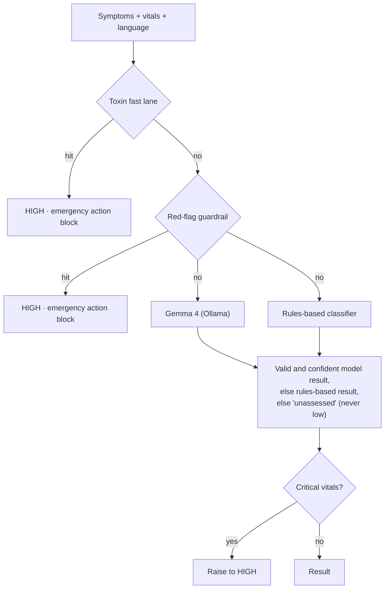

# Architecture

HealStation AI is a single offline process: a FastAPI backend that also serves the built React UI, talking
to a local Ollama server for Gemma 4. Decisions behind this layout are recorded in [ADRs](adr/).

## Module map

| Package | Responsibility |
|---|---|
| `api.py` | Entry point (`python api.py`, `uvicorn api:app`) |
| `config.py` | The only module that reads the environment |
| `healstation/api/app.py` | App factory: middleware, CORS, routers, bundled UI |
| `healstation/api/v1.py` | Version 1 HTTP endpoints (deprecated) |
| `healstation/triage/toxin.py` | Toxin / poisoning fast lane |
| `healstation/triage/guardrails.py` | Red-flag guardrail (keywords, patterns, negation) and emergency action blocks |
| `healstation/triage/vitals.py` | Vital-sign parsing and the critical-vitals floor |
| `healstation/triage/model_client.py` | Gemma 4 call through Ollama `/api/chat`; output parsing and normalisation |
| `healstation/triage/prompts.py` | Prompts and their version |
| `healstation/triage/fallback.py` | Rules-based classifier wrapper (`emergency_triage`) |
| `healstation/triage/pipeline.py` | The triage decision: rules → model → fallback → vitals floor |
| `healstation/triage/localization.py` | User-facing triage text in en/hi/mr |
| `healstation/triage/consensus.py` | Explainability summary across inputs |
| `healstation/speech/` | faster-whisper STT, pyttsx3 TTS, response-audio files |
| `healstation/directory/` | Static specialist directory |
| `emergency_triage/` | HEART / BE-FAST / trauma scoring, triage levels, hospital routing, fairness metrics |

Dependencies point inward: `api → triage`; `triage` imports nothing from the HTTP layer.

## Triage flow

The invariants this flow must keep are listed in PRD §5 (INV-1..INV-10).
